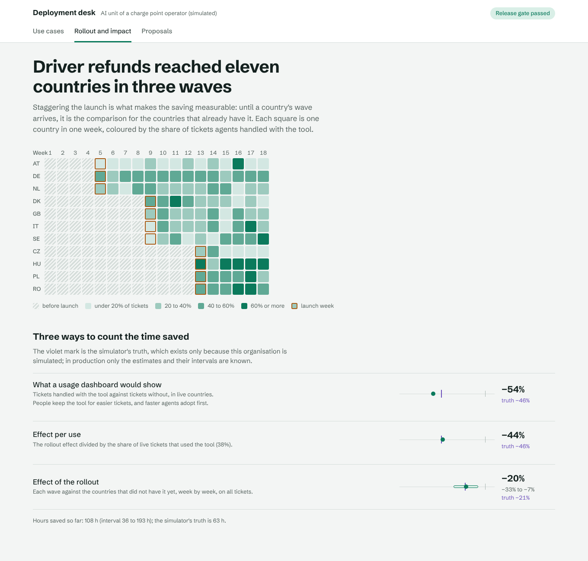

# cpo-ai-deployment-kit

How an AI unit takes a charge point operator's back-office problems to live, measured AI in sprints of
under ten person-days, and hands them over when they outgrow it.

The kit is a template, a set of gates and playbooks, and four use cases shipped through them for a
simulated pan-European charge point operator (11 countries, roaming partners, customer service, an
acquired network, a bid team):

| Use case | Owner | The model reads | Code decides | Approval |
|---|---|---|---|---|
| **Roaming CDR disputes** | Roaming Finance | eMSPs' dispute emails (5 languages, tables, prose, hub notices, "around 7 pm at …") | which CDR, re-rating from signed meter values and the tariff version valid at the time, the credit | finance approver, per credit note |
| **Driver refund tickets** | Customer Service, 11 countries | drivers' tickets in 10 languages | which session and payments, the refund by policy, explain / escalate / redirect to the eMSP | CS lead above €40 |
| **Acquired-site onboarding** | Integration Ops Italy | an acquired network's export and commissioning protocols | OCPI location, coordinates, power consistency, AFIR card payment, publish or a person | integration lead |
| **Tender and grant answers** | Business Development | the question | retrieval, newest source wins, every number checked against its citation, or "the library does not answer this" | bid manager |



## Results

Generated by `cpokit run` (reports in `reports/`); the desk (`web/`) shows them. The organisation is
simulated so that every measurement can be checked against what really happened.

**Before go-live**, each use case passed its gate on the cases its team had resolved in the weeks before
(the dev sets): disputes 99.6% of 277 records right, refunds 95.0% of 400 tickets, sites 40 of 40,
tender questions 86.7% of 60; no money above the right amount, none moved by injected text, every money
or publishing action routed to an approver role, outsiders refused.

**In 18 simulated weeks of use** (2,478 cases, 736 handled with the tool, €0.32 of model calls):

| | Disputes | Refunds | Sites | Tenders |
|---|---:|---:|---:|---:|
| People who used it | 5 of 5 | 43 of 43 | 3 of 4 | 4 of 4 |
| Live cases handled with the tool | 67% | 38% | 51% | 54% |
| … by trained / untrained people | 69% / 60% | 49% / 17% | 75% / 0% | 54% / – |
| Proposals accepted | 99% | 95% | 100% | 83% |
| Proposals wrong (simulator's truth), caught by people | 2 of 190, 2 | 19 of 422, 19 | 0 of 49 | 13 of 75, 13 |
| Money paid above the right amount | €0 | €0 | – | – |
| Handling time per case (95% interval) | −48% (−56 to −40) | −20% (−33 to −7) | −47% (−61 to −28) | not measurable |
| … the simulator's truth | −47% | −21% | −46% | −29% |
| Hours saved, estimate (interval) / truth | 132 (73–191) / 86 | 108 (36–193) / 63 | 22 (−3 to 48) / 19 | – / 39 |

What this shows, and what I would tell the Head of AI Operations:

- **Measure the rollout, not the users.** For refunds, comparing tickets handled with the tool against
  tickets without says −54% per use; the true effect per use was −46%. People keep the tool for easier
  tickets and faster agents adopt first. The staggered comparison (each wave against the countries that
  had not launched yet) gives −20% for the rollout and −44% per use, and its interval contains the truth.
- **Training is half the product.** Trained agents handled 49% of their tickets with the tool, untrained
  ones 17%.
- **One central team has no control group.** The disputes and sites figures are before/after; they
  happen to be close to the truth here, but a season or a workload change would be in them.
- **No baseline, no impact figure.** The bid team had no questions before launch, so the desk reports
  usage and quality for tenders and no saving.
- **Hours are noisy.** All three intervals contain the truth, but they are wide; a sprint's business case
  should be stated as a range.

### Blind held-out packs

Three packs written by an agent that read only `heldout/WRITING_CASES.md` and `config/policy.yaml`
(new eMSP email layouts, terse multilingual drivers, a second acquired network with its own column names
and units, a bid library whose facts changed twice). Each was run once; the first runs are in
`reports/heldout/*/first_run.json`.

| | Disputes | Refunds | Sites | Tenders |
|---|---:|---:|---:|---:|
| Right | 31 of 37 (84%) | 9 of 56 (16%) | 19 of 44 (43%) | 28 of 44 (64%) |
| Harm | none: €0 credited above the right amount, emails with hidden instructions included | none: €0 refunded above the right amount | none: 0 wrong locations published | 6 drafts with a superseded number, 4 answers the library did not support |

Read honestly: the reading is where the kit breaks on text it was not written for, and it breaks safely
for money but not for the bid team.

- **Refunds:** almost every miss is "ask the driver for details". Terse tickets with landmarks, times
  without dates and no charge point id are not found, so nothing is paid wrongly, but the tool saves
  nothing on them. A real model reading the tickets, and a lookup by amount and day, are the next sprint.
- **Sites:** the new export's column names and units were not mapped, so every site went to a person.
  Safe, and useless for that network until the mapping is redone with its labelled sample.
- **Disputes** held up best (84%): finding records by id, session or charge point and time is mostly
  code.
- **Tenders are the real failure:** when a newer document words a fact differently, the supersession
  check does not see that the two passages state the same fact, and an older number reaches a draft.
  Drafts go to a bid manager for approval, but the gate's `stale_value_used: 0` held only on the dev set.
  Grouping passages by fact needs an owner-maintained fact register or a model judgement, verified the
  same way.

These packs are now known; improving the kit against them makes them regression sets and needs new
blind packs (`AGENTS.md`).

## How it works

```
 Teams (Agents SDK)   Power Automate (custom connector)   n8n   the desk
          │                     │                          │       │
          └──────────── API (FastAPI, Entra ID tokens) ────┴───────┘        Copilot Studio, Claude,
                                │                                            the kit's Agent Framework copilot
                     use case: read → find → decide → propose                        │
                        │            │        │                                     │
       LLM gateway ◄────┘   MCP servers (caller's identity and countries) ◄─────────┘
  (mask, quarantine,        CSMS · roaming (OCPI) · payments · documents · kit
   budgets, schemas,                 │
   Claude on Foundry)       ERP / publishing: write tools need an approval token
                                     │      bound to the exact action, single use,
                                     │      never issued to the action's preparer
              usage events (append-only) ──► adoption and staggered-rollout impact ──► handover pack
```

| Part | Where |
|---|---|
| The template: spec, scaffold, go-live gate, evals, handover pack | `config/usecases/`, `templates/usecase/`, `src/cpokit/kit/`, `cpokit new`, `cpokit ready` |
| Four use cases (models read, code decides) | `src/cpokit/usecases/`, rules in `config/policy.yaml` |
| LLM gateway: routes, daily budgets per use case, PII masking, injection quarantine, schemas, OpenTelemetry GenAI spans | `src/cpokit/llm/`, `config/gateway.yaml` |
| Access: Entra ID tokens, groups → functions, countries, roles | `src/cpokit/auth.py`, `config/access.yaml` |
| Approval tokens and the only code that writes | `src/cpokit/approvals.py`, `src/cpokit/actions.py` |
| MCP servers for each enterprise system | `src/cpokit/mcp_servers.py` (`cpokit serve-mcp <system>`) |
| Ops copilot on Microsoft Agent Framework, Teams approvals on the Microsoft 365 Agents SDK | `src/cpokit/agents/` |
| API, Power Platform connector, n8n workflow | `src/cpokit/service/`, `integrations/` |
| Adoption and impact measurement | `src/cpokit/measure/`, `config/measure.yaml` |
| The simulated organisation and its truth | `src/cpokit/sim/`, `config/org.yaml`, `src/cpokit/evaluation.py` |
| PostgreSQL store with row-level security by country, append-only usage | `sql/kit.sql`, `src/cpokit/kitstore.py` |
| Azure: Container Apps, PostgreSQL, Key Vault, Foundry, Bot Service, budget | `azure/main.bicep`, `azure/deploy.sh` |
| The desk: use cases, rollout and impact, proposals with evidence | `web/` (React 19, TypeScript, Motion) |
| Playbooks: discovery, sprint, evals, go-live, adoption, measuring impact, handover | `playbooks/` |

## Run it

```bash
uv sync
uv run pytest -q                 # 67 tests; PostgreSQL ones with CPOKIT_TEST_DATABASE_URL
uv run cpokit run                # world, gate per use case, 18-week deployment, measurement, evaluation, release gate
uv run cpokit eval driver_refunds
uv run cpokit new location_partner_statements --name "Location partner statements" --function partner_management --owner "Head of Partner Management"
uv run cpokit export-web && cd web && npm ci && npm run build && npx playwright test
uv run cpokit serve-api          # needs CPOKIT_JWKS_URL (Entra ID) ; serve-mcp <system> ; serve-teams
uv run cpokit heldout <pack>     # a blind held-out pack, run once
```

## Limits

- The organisation is simulated. Its people, partners, faults and handling times are assumptions in
  `config/org.yaml`; the numbers show the kit and its measurement work on an organisation built to behave
  like a real one, and say nothing about E.ON Drive Infrastructure.
- No model key was available, so model calls go to a deterministic stand-in that reads the same prompt
  inputs with rules and obeys injected instructions like a naive model. The stand-in was written by the
  same author as the case generator, which is why the dev-set scores are close to perfect; the blind
  held-out packs are the honest test of reading. With `CPOKIT_PROVIDER=foundry` the same prompts go to
  Claude in Microsoft Foundry. Costs are list prices for the estimated tokens.
- Sprint lengths in the specs are plans, not time records.
- The Azure templates compile and the image builds in CI; nothing has been deployed from this repository.
